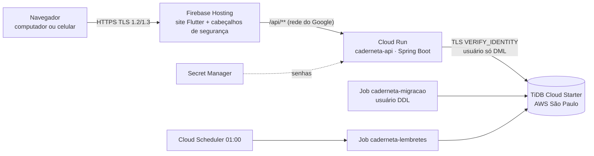

# Caderneta — Gestão de Vendas a Prazo

**A caderneta de fiado do comércio, agora digital.** Sistema web para lojas registrarem vendas a
prazo, controlarem o que cada cliente deve e acompanharem pagamentos e vencimentos — do mercado à
loja de roupas e ao vendedor ambulante. **Várias lojas usam o mesmo sistema**, e cada uma só enxerga
os próprios clientes, vendas e funcionários.

🌐 **Em produção:** https://caderneta01.web.app

Este é o **repositório integrador**: reúne a API e o frontend como **submódulos Git**, orquestra o
ambiente local com Docker Compose e guarda os testes de navegador, de carga e a documentação de
operação.

| Submódulo | Pasta | Repositório | Tecnologia |
|---|---|---|---|
| **API** | [`backend-repo/`](backend-repo/) | [EduardoBR2003/api-caderneta](https://github.com/EduardoBR2003/api-caderneta) | Java 21 · Spring Boot 4.1 · Hibernate 7 · Flyway · MySQL 8.4 / TiDB |
| **Frontend** | [`frontend-repo/`](frontend-repo/) | [Artur-Duarte17/Caderneta](https://github.com/Artur-Duarte17/Caderneta) | Flutter Web 3.47.9 · NGINX (local) · Firebase Hosting |

📘 Detalhes técnicos e **segurança** de cada parte: [README da API](backend-repo/README.md) ·
[README do frontend](frontend-repo/README.md).

---

## Sumário

1. [O que o sistema faz](#1-o-que-o-sistema-faz)
2. [Perfis de acesso](#2-perfis-de-acesso)
3. [Várias lojas](#3-várias-lojas)
4. [Arquitetura](#4-arquitetura)
5. [Segurança — visão geral](#5-segurança--visão-geral)
6. [Executar localmente](#6-executar-localmente)
7. [Testes](#7-testes)
8. [Produção](#8-produção)
9. [Operação: migrations, backup e publicação](#9-operação-migrations-backup-e-publicação)
10. [Estrutura deste repositório](#10-estrutura-deste-repositório)
11. [Solução de problemas](#11-solução-de-problemas)
12. [Situação atual e próximos passos](#12-situação-atual-e-próximos-passos)
13. [Equipe](#13-equipe)

---

## 1. O que o sistema faz

| Área | Funcionalidades |
|---|---|
| **Lojas** | Cadastro público ("Criar minha loja"): o lojista cria a loja e vira o gerente. Nome da loja no menu. |
| **Clientes** | Cadastro com limite de crédito e prazo de pagamento, fiador opcional, busca por nome ou telefone, situação (em dia, devendo, em atraso), detalhes financeiros (saldo, crédito disponível). |
| **Vendas a prazo** | Venda com um ou vários itens; gera a **dívida** com vencimento automático pelo prazo do cliente; recusa venda acima do **limite de crédito**; filtros por status e período; edição; comprovante para impressão. |
| **Pagamentos** | Parciais ou totais, em dinheiro, PIX, cartão de crédito/débito, transferência ou boleto; saldo e situação atualizados na hora; renegociação de vencimento; comprovante. |
| **Lembretes** | Tarefa diária (01:00, horário de Brasília) gera aviso para cada dívida que vence no dia ou já venceu, sem duplicar. |
| **Painel e relatórios** | Visão Geral (a receber, vendido no mês, recebido); relatórios de vendas, dívidas e clientes por período, com gráficos e exportação CSV. |
| **Histórico e auditoria** | Linha do tempo de eventos (atualiza sozinha); auditoria com quem fez o quê, quando e o antes/depois. |
| **Equipe** | Gerente cria funcionários, ativa/desativa, **promove a gerente** (mesmo login), **exclui sem apagar o histórico** e **restaura**; recadastrar o CPF de um excluído reativa a conta antiga. |
| **Área do cliente** | Com o convite da loja, o cliente cria o acesso e acompanha compras, dívidas, vencimentos e pagamentos. |
| **Usabilidade** | Funciona no computador e no celular; máscaras e validação em todos os campos; indicadores de carregamento em todas as esperas. |

---

## 2. Perfis de acesso

| Perfil | O que faz |
|---|---|
| **Gerente** | Tudo da loja: operação, limite de crédito e prazo, relatórios, auditoria, contas da equipe. |
| **Funcionário** | Clientes, fiadores, vendas (edita só as próprias), pagamentos, histórico e convites. |
| **Cliente** | Só "Minha caderneta": as próprias compras, dívidas e pagamentos naquela loja. |

As permissões são verificadas **na API** em toda requisição; a interface só esconde o que o perfil
não pode usar. Cada loja precisa manter pelo menos um gerente ativo.

---

## 3. Várias lojas

- **Um sistema, várias lojas:** cada registro pertence a uma loja (`loja_id`), e a API isola os dados
  em camadas — filtro automático do Hibernate, trava que responde "não encontrado" para registros de
  outra loja e filtros explícitos no SQL escrito à mão. Testado de ponta a ponta com duas lojas
  tentando ler, alterar e apagar dados uma da outra.
- **Contas:** cada login pertence a **uma** loja e é único no sistema inteiro; quem trabalha (ou
  compra) em duas lojas tem dois logins.
- **CPF:** único **por loja e papel** — o mesmo cliente pode ser cadastrado em várias lojas, e na
  mesma loja uma pessoa pode ser cliente, funcionário e fiador (o cliente não pode ser fiador de si
  mesmo).
- **Dados anteriores às lojas** estão na **"Loja Principal"**.
- **Limite de cadastros de loja:** 5 por IP a cada 15 min (contra cadastros em massa). Numa sala de
  aula, todos saem pelo mesmo IP — aumente `CADERNETA_CADASTRO_LOJA_MAX_POR_IP` no dia.

---

## 4. Arquitetura



- **Mesma origem:** o site e a API ficam no mesmo endereço (`/api` reencaminhado), então o cookie de
  sessão funciona sem CORS. O Firebase Hosting só repassa o cookie `__session`, nome usado pela API.
- **Produção:** Firebase Hosting + Cloud Run `southamerica-east1` (mínimo 0 / máximo 2 instâncias;
  sem custo parado) + TiDB Cloud Starter em São Paulo + Secret Manager + Artifact Registry + Cloud
  Scheduler.
- **Local:** Docker Compose com a mesma divisão — `mysql` → `migracao` (tarefa única) → `backend` →
  `frontend` (NGINX fazendo o papel do Firebase Hosting).

---

## 5. Segurança — visão geral

Resumo do que foi implementado (detalhes, configurações e justificativas nos READMEs da
[API](backend-repo/README.md#4-segurança) e do [frontend](frontend-repo/README.md#3-segurança)):

| Tema | Implementação |
|---|---|
| **Criptografia em trânsito** | HTTPS obrigatório; só TLS 1.2/1.3 (1.0/1.1 recusados, verificado); HSTS com *preload*; API → banco com TLS e verificação de certificado e nome (`VERIFY_IDENTITY`). |
| **Senhas** | BCrypt com *salt*; sem senha padrão; senhas do banco no Secret Manager (produção) ou `.env` ignorado pelo Git (local). |
| **Banco** | Dois usuários: a API só lê e grava dados (sem DDL); as migrations usam outro usuário, numa tarefa separada. |
| **Sessão** | No servidor (Spring Session JDBC); cookie `HttpOnly`, `Secure`, `SameSite=Lax`; expira em 30 min sem uso; id e token CSRF renovados no login; desativar/excluir/promover encerra as sessões da conta. |
| **CSRF** | Token obrigatório (`X-CSRF-TOKEN`) em toda alteração. |
| **Abuso** | Bloqueio após 5 falhas por login / 30 por IP (vale até com a senha certa durante o bloqueio); mensagem de login neutra; limite de cadastros de loja; convites de uso único (100 bits, só o hash no banco, 7 dias). |
| **Isolamento** | Entre lojas (camadas acima) e entre perfis (verificação no servidor; rotas não listadas são negadas). |
| **Integridade financeira** | Idempotência em vendas e pagamentos; travas no banco contra pagamentos concorrentes e estouro de limite; controle de versão na edição de vendas. |
| **Navegador** | CSP restritiva (`connect-src 'self'`, `frame-ancestors 'none'`), `X-Frame-Options`, `nosniff`, `Referrer-Policy`, `Permissions-Policy`; API com `no-store`; nada sensível no `localStorage`; token CSRF só em memória. |
| **Privacidade** | Logs sem CPF nem valores duplicados; erros sem detalhes internos; registro de outra loja responde 404 (não revela que existe). |
| **Auditoria** | Ações administrativas e financeiras com autor, data e antes/depois. |
| **Cadeia de entrega** | Imagens com usuário sem privilégios e `apk upgrade`; Flutter conferido por SHA-256; `pubspec.lock` obrigatório; gitleaks e Trivy no CI; contas de serviço com permissão mínima. |

---

## 6. Executar localmente

**Pré-requisitos:** Docker com Compose v2.
Flutter 3.47.9 só é necessário para o `./subir.sh` ou para desenvolver o frontend.

```bash
git clone --recurse-submodules https://github.com/LuisHRodrigues/Projeto_Final_Caderneta.git
cd Projeto_Final_Caderneta
cp .env.example .env        # preencha as 3 senhas (openssl rand -base64 24); não há senha padrão
docker compose up -d --build
```

Para testar em **HTTP** no `localhost`, use `SPRING_PROFILES_ACTIVE=dev` no `.env` (o perfil padrão
exige HTTPS no cookie). Para carregar **dados fictícios**, acrescente
`CADERNETA_FLYWAY_LOCATIONS=classpath:db/migration,classpath:db/dev`.

| Serviço | Endereço |
|---|---|
| Site | http://localhost:3000 |
| API (direta) | http://localhost:8082 (o navegador usa `/api` em :3000) |
| Swagger | http://localhost:8082/swagger-ui.html (login de gerente) |
| MySQL | `127.0.0.1:3307` (só a própria máquina) |

**Contas fictícias** (só com os dados de desenvolvimento, na "Loja Principal"): `dev.gerente` /
`DevGerente#2026`, `dev.funcionario` / `DevFunc#2026`, `dev.cliente1` / `DevCliente1#2026`,
`dev.cliente2` / `DevCliente2#2026`. O primeiro gerente de um banco vazio vem das variáveis
`CADERNETA_BOOTSTRAP_*` do `.env` (preencha, suba uma vez e apague).

Comandos úteis: `docker compose logs -f backend` · `docker compose down` (não apaga o banco) ·
`./subir.sh` (build do Flutter fora do Docker, mais leve). Guia completo:
[`docs/operacao-local.md`](docs/operacao-local.md); variáveis:
[`docs/variaveis-de-ambiente.md`](docs/variaveis-de-ambiente.md).

**Homologação no Windows:** scripts PowerShell em [`scripts/`](scripts/) (`Preparar-Homologacao.ps1`,
`Atualizar-Local.ps1`, `Backup-Caderneta.ps1`, `Agendar-Backup.ps1`, `Preparar-Entrega.ps1`) e os
arquivos `docker-compose.homologacao.yml` / `docker-compose.producao.yml`. Foram escritos para a
versão anterior do Compose e podem precisar de ajuste.

---

## 7. Testes

| Camada | Onde | Comando | Resultado atual |
|---|---|---|---|
| API — unitários | `backend-repo` | `mvn test` | 80/80 |
| API — integração (MySQL 8.4 e TiDB 8.5, Testcontainers) | `backend-repo` | `mvn verify` | 12/12 API (inclui isolamento entre lojas) + 5/5 migrações |
| Frontend — unitários e de tela | `frontend-repo` | `flutter test` | 116/116 |
| NGINX (cabeçalhos, SPA, proxy) | `frontend-repo` | `scripts/verify_nginx.sh` | aprovado |
| Navegador de ponta a ponta (Playwright, Chromium) | [`e2e/`](e2e/) | ver abaixo | 4/4 local; 3/3 em produção (sem login) |
| Carga (k6) | [`e2e/carga/`](e2e/carga/) | ver abaixo | 20 usuários/60 s, 0% de erro (medição anterior) |

```bash
set -a; . ./.env; set +a
docker run --rm --network host -e E2E_LOGIN=dev.gerente -e 'E2E_SENHA=DevGerente#2026' \
  -e E2E_COOKIE_SEGURO=false -e E2E_COOKIE=SESSION -v "$PWD/e2e:/e2e" -w /e2e \
  mcr.microsoft.com/playwright:v1.64.1-noble bash -c 'npm install && npx playwright test'
docker run --rm --network host -v "$PWD/e2e/carga:/s" grafana/k6:1.3.0 run \
  -e LOGIN=dev.gerente -e 'SENHA=DevGerente#2026' /s/leitura.js
```

O workflow [`.github/workflows/e2e.yml`](.github/workflows/e2e.yml) sobe a pilha com senhas
aleatórias e roda Playwright e k6 (pull request e acionamento manual).

---

## 8. Produção

| Recurso | Configuração |
|---|---|
| Site | Firebase Hosting `caderneta01` — https://caderneta01.web.app |
| API | Cloud Run `caderneta-api` (`southamerica-east1`), 1 vCPU, 512 MiB, 0–2 instâncias, conta de serviço `caderneta-api-run` |
| Banco | TiDB Cloud Starter (AWS `sa-east-1`), banco `api_caderneta_database`, versão de esquema 12 |
| Tarefas | Jobs `caderneta-migracao` e `caderneta-lembretes`; Cloud Scheduler `caderneta-lembretes-diario` (01:00 BRT) |
| Segredos | Secret Manager: `caderneta-db-password`, `caderneta-migration-password`, `caderneta-bootstrap-senha` (desativado) |
| Imagens | Artifact Registry `caderneta` (mantém só as mais recentes) |

O primeiro acesso depois de um tempo parado leva alguns segundos (a API inicia do zero, já que o
mínimo é 0 instâncias). Todos os indicadores de carregamento cobrem essa espera.

---

## 9. Operação: migrations, backup e publicação

- **A API não altera a estrutura do banco.** As migrations (Flyway) rodam antes, na tarefa
  `migracao`, com o usuário de DDL. Não reescreva migrations já aplicadas.
- **Backup antes de migrar produção:** `mysqldump` com TLS e o usuário de migração — no TiDB,
  **sem** `--single-transaction` (o TiDB não tem `SAVEPOINT`). Guarde o arquivo fora dos
  repositórios: ele contém dados pessoais.
- **Ordem de publicação:** backup → imagem nova no Artifact Registry → executar o Job
  `caderneta-migracao` → publicar `caderneta-api` e atualizar `caderneta-lembretes` → publicar o site
  (`firebase deploy --only hosting --project caderneta01`) → verificar `/api/saude`, rotas e logs.
- **Voltar uma versão:** Cloud Run (revisão anterior) e Firebase Hosting (histórico de versões).
- **CI/CD:** os workflows dos submódulos testam em todo push/PR; a implantação por eles é manual
  (`workflow_dispatch`) com Workload Identity Federation — a configuração no GitHub ainda não foi
  concluída, por isso as publicações atuais são feitas pelo terminal.
- **Submódulos:** depois de publicar uma versão nova da API ou do frontend na `main`, atualize o
  ponteiro aqui (`git add backend-repo frontend-repo`).

---

## 10. Estrutura deste repositório

```
Projeto_Final_Caderneta/
├── backend-repo/                  # submódulo: API (ver README próprio)
├── frontend-repo/                 # submódulo: frontend (ver README próprio)
├── docker-compose.yml             # pilha local: mysql → migracao → backend → frontend
├── docker-compose.homologacao.yml # homologação (scripts PowerShell)
├── docker-compose.producao.yml    # variante com NGINX em HTTPS (servidor próprio)
├── .env.example                   # modelo do .env (senhas obrigatórias, sem padrão)
├── subir.sh                       # build leve: Flutter fora do Docker + compose
├── e2e/                           # Playwright (navegador) e k6 (carga)
├── scripts/                       # homologação, backup e verificações
├── docs/                          # operação, variáveis, contratos, homologação, usabilidade
└── .github/workflows/e2e.yml      # pilha completa + Playwright + k6
```

Documentos principais em [`docs/`](docs/): [operação local](docs/operacao-local.md) ·
[variáveis de ambiente](docs/variaveis-de-ambiente.md) ·
[contratos e permissões](docs/contratos-e-permissoes.md) ·
[integração do backend](docs/backend-integracao.md) · [integração do frontend](docs/integracao-frontend.md) ·
[entrega de homologação](docs/entrega-homologacao-2026-11-05.md) ·
[teste de usabilidade](docs/teste-usabilidade-2026-11-07.md).

---

## 11. Solução de problemas

| Sintoma | O que fazer |
|---|---|
| O compose não sobe ("defina ... no .env") | Preencha as 3 senhas no `.env`. |
| Login local não mantém a sessão | Em HTTP, use `SPRING_PROFILES_ACTIVE=dev` no `.env` (o cookie padrão exige HTTPS). |
| "Muitas tentativas" (429) | Bloqueio de 15 min por falhas de login; aguarde ou ajuste `CADERNETA_LOGIN_*`. |
| "Não foi possível criar a loja" em sala de aula | Limite de cadastros por IP; aumente `CADERNETA_CADASTRO_LOJA_MAX_POR_IP`. |
| Página abre sem dados | `docker compose logs backend`; `curl http://localhost:3000/api/saude`; console do navegador (F12). |
| Primeiro acesso lento em produção | Normal: a API inicia do zero após um tempo parado. |
| Ícone antigo na aba | Recarregue com Ctrl+Shift+R (o navegador guarda o favicon). |
| `docker` não encontra o daemon | Confira o contexto ativo (`docker context ls`); se o do Docker Desktop estiver com problema, use `docker --context default ...`. |

---

## 12. Situação atual e próximos passos

**Pronto e em produção:** tudo descrito nas seções 1 a 5.

**Próximos passos possíveis:**
- **Conta única do cliente** para acompanhar todas as lojas em que compra (planejada, adiada).
- Tela de notificações com "marcar como lida" e botão "Avisar no WhatsApp" (planejado, sem provedor
  pago).
- Renomear a loja e administração da plataforma (listar/desativar lojas).
- Validação do formato do telefone também na API.
- Concluir o Workload Identity Federation para publicar pelo GitHub Actions.
- Domínio próprio no Firebase Hosting (certificado HTTPS gratuito).

---

## 13. Equipe

Projeto Final do Bacharelado em Sistemas de Informação — **Instituto Federal Goiano, Campus
Urutaí** (8º período, 2026): Artur Duarte, Eduardo Rodrigues, Guilherme Pereira, Laila Bianca,
Leonan Silva e Luis Henrique.
